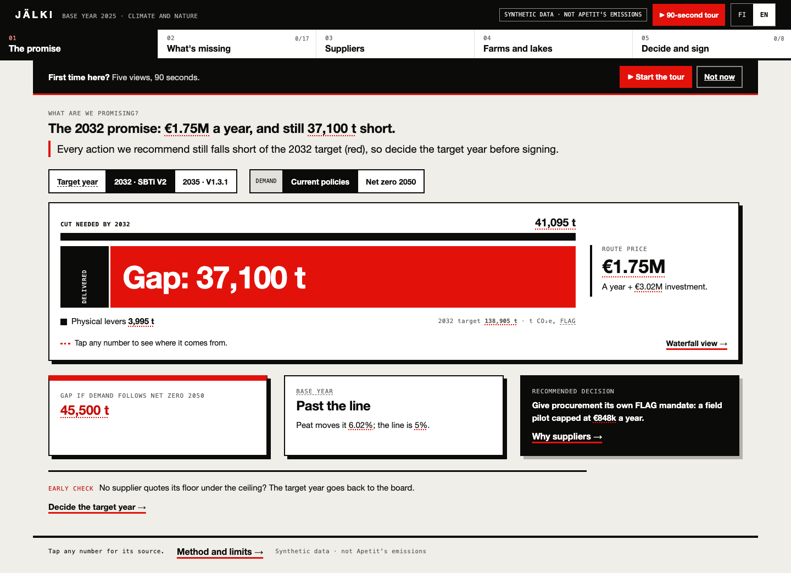
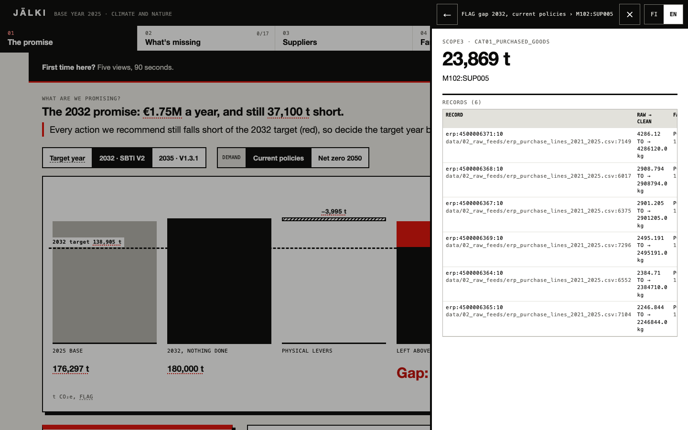

# JÄLKI

**[Open Jälki](https://jalki.mi11ion.io)** and press **90-second tour**. It works in the browser on a laptop or a phone, in English or Finnish, with nothing to install.

Jälki shows a food company's board what its climate promise commits it to and what it costs, shows the sustainability team what data is still missing, and lets every number open down to the record it came from. Built for Apetit's Climate & Nature Navigator challenge at Since AI 2026.

▶ **Video (2 min):** _link added at submission_

## The five views

| View | What it answers |
|---|---|
| **The promise** | What the 2032 target costs a year (€1.75M on the recommended route) and how far it still falls short (37,100 t). The board picks the target year first. |
| **What's missing** | The data still missing for SBTi FLAG, the GHG Protocol and SBTN: 17 requirements, ranked by impact per day of effort. The AI drafts each next step with its source; an expert approves it or sends it back. |
| **Suppliers** | Each supplier's own footprint against last year. All five rapeseed suppliers moved more in a year than the cut that would be asked of them, so the recommended pilot pays per tonne proven in field records. |
| **Farms and lakes** | Eutrophication by catchment. The ten biggest CO₂ farms carry 29.6% of farm CO₂e but 2.5% of the phosphorus to water; no farm is on both top-ten lists. |
| **Decide and sign** | Eight decisions, each with an owner; corrections reviewed one at a time; the 2025 base signed and frozen into a record that replays its own checks. |

Tap any number: one drawer shows how it is made, the script that prints it, and the records underneath.

## How it is built

- `pipeline/` is Python. From the organisers' raw pack it rebuilds the 2025 inventory, the route and its costs, the supplier checks, the nature ranking and the data bundle the app reads, with a trail from each number to its source rows. The full run takes about six minutes on a laptop. One command: `python3 pipeline/run_all.py --package <unzipped pack> --out build`. The facts check runs first.
- `app/` is the result: a static web app (HTML, CSS, JavaScript, no server, no network calls). Open `app/index.html` from disk or host the folder anywhere: Azure Static Web Apps, a Teams tab, any web server.
- Numbers never come from a language model. The AI is used to draft the next step for each data gap from the framework texts; those drafts were generated ahead of the demo and are shown as **AI DRAFT** until a person approves them.

## Real and synthetic

The app, the pipeline, the trail behind every number, and the signing and replay are real and run as shown. The data is the organisers' synthetic challenge pack (CC BY 4.0, © Since AI ry 2026). No figure is Apetit's real emissions. Approver roles in the demo are simulated.

## More

- [Method and limits](docs/method.md)
- Pilot plan for Apetit and the pitch deck: in `docs/`
- Screens: `screens/`

Team: The Confession Company.
